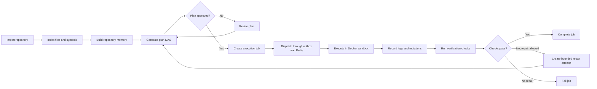
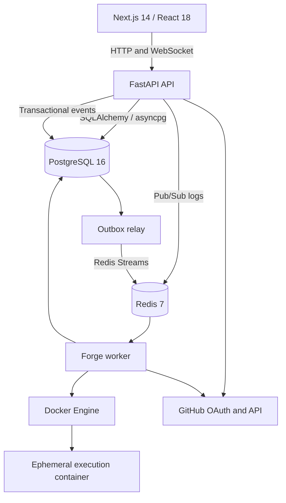

# Forge

Forge is a repository-aware software engineering system that imports and indexes source repositories, builds structural code memory, turns an approved intent into an execution plan, runs that plan in a Docker sandbox, records mutations and logs, and verifies the result with a bounded repair path.

The project is an internal alpha. Its architecture and security controls are implemented and tested, but Forge should not be treated as a hosted production service or used to execute untrusted repositories without reviewing the deployment, Docker daemon exposure, credentials, and network policy.

## What Forge contains

- A FastAPI API for authentication, repositories, indexing, planning, execution, verification, patches, audit data, and workspace administration.
- A Next.js App Router frontend for the repository-to-execution workflow and live execution output.
- An asynchronous worker backed by a PostgreSQL transactional outbox and Redis Streams.
- Repository scanning, language/framework detection, Tree-sitter parsing, symbol storage, and graph-oriented memory construction.
- Plan approval and execution state machines with persisted logs and mutations.
- Docker-backed command execution and verification, including network-disabled verification sandboxes.
- GitHub OAuth, webhook handling, encrypted provider credentials, role-based permissions, and PostgreSQL row-level security migrations.

## Lifecycle



## Architecture



The repository keeps deployable applications in `apps/`, reusable infrastructure in `packages/`, domain logic in `services/`, schema history in `migrations/`, and container definitions in `docker/`.

### Backend

- Python package requirement: Python 3.12 or newer. The codebase uses Python 3.12 type-parameter syntax.
- Container runtime: Python 3.12.
- FastAPI, Pydantic 2, SQLAlchemy 2, asyncpg, Alembic, Redis, LiteLLM, NetworkX, and Tree-sitter.
- PostgreSQL is the system of record. Redis provides streams for worker delivery and Pub/Sub for live logs.

### Frontend

- Next.js 14.2.35 with the App Router.
- React and React DOM 18.3.1.
- TypeScript 5.9.3, Playwright, React Query, Zustand, Radix primitives, and custom CSS.

### Execution and verification

`apps/worker` constructs a `DockerSandbox` and consumes domain events from Redis. The runtime mounts a per-job workspace, applies limits, captures output, and persists execution state. Verification uses a network-disabled Docker sandbox. A local-process implementation remains available for trusted test fixtures and must not be used as an isolation boundary for untrusted code.

The worker mounts the host Docker socket in the Compose development stack. Access to that socket is effectively host-level access; deploy the worker only in a trusted environment and review the `DOCKER_GID` mapping for the host.

## Repository layout

```text
Forge/
├── .github/
│   ├── dependabot.yml
│   └── pull_request_template.md
├── apps/
│   ├── api/
│   ├── frontend/
│   └── worker/
├── docker/
│   ├── Dockerfile.api
│   ├── Dockerfile.frontend
│   ├── Dockerfile.sandbox-node
│   ├── Dockerfile.sandbox-python
│   └── Dockerfile.worker
├── docs/
│   ├── archive/
│   ├── ui/
│   └── README.md
├── migrations/
├── packages/
│   ├── database/
│   ├── events/
│   ├── sdk/
│   └── shared/
├── scripts/
│   ├── database/
│   ├── development/
│   ├── diagnostics/
│   └── windows/
├── services/
├── tests/
│   ├── e2e/
│   ├── fixtures/
│   ├── integration/
│   └── security/
├── alembic.ini
├── docker-compose.yml
├── pyproject.toml
└── uv.lock
```

See the [documentation index](docs/README.md) for current UI references and archived implementation reports.

## Prerequisites

- Python 3.12, matching the container images.
- [`uv`](https://docs.astral.sh/uv/) for the locked Python environment.
- Node.js 20+ and npm for local frontend development. The frontend image uses Node 24.
- Docker Engine with the Compose plugin.
- PostgreSQL 16 and Redis 7, either locally or through Compose.

## Configuration

Copy the example files before starting local services:

```bash
cp .env.example .env
cp apps/frontend/.env.example apps/frontend/.env.local
```

On PowerShell:

```powershell
Copy-Item .env.example .env
Copy-Item apps/frontend/.env.example apps/frontend/.env.local
```

Important backend variables are listed below. The canonical defaults and the complete list live in [`.env.example`](.env.example).

| Variable | Purpose |
| --- | --- |
| `DATABASE_URL` | Async SQLAlchemy PostgreSQL connection URL. |
| `REDIS_URL` | Redis Streams and Pub/Sub connection URL. |
| `WORKSPACE_ROOT` | Host path used for cloned and execution workspaces. |
| `GITHUB_CLIENT_ID` / `GITHUB_CLIENT_SECRET` | GitHub OAuth application credentials. |
| `GITHUB_WEBHOOK_SECRET` | Signature secret for GitHub webhook delivery. |
| `SECRET_KEY` | Application signing secret. Replace the development placeholder outside local use. |
| `ENCRYPTION_KEY` | Key material used to protect stored provider credentials. Required in production. |
| `FRONTEND_URL` / `CORS_ORIGINS` | Browser origin configuration. |
| `SANDBOX_IMAGES` | Configured sandbox image allow-list. |
| `DOCKER_GID` | Optional host Docker group ID supplied to the Compose worker. |

`ForgeSettings` rejects the known development secret and missing encryption, database, Redis, GitHub OAuth, frontend, or sandbox configuration when `ENVIRONMENT=production`.

## Local development

### 1. Install backend dependencies

```bash
uv sync --frozen --all-extras
```

### 2. Start PostgreSQL and Redis

```bash
docker compose up -d postgres redis
```

### 3. Apply migrations

```bash
uv run alembic upgrade head
```

### 4. Start the API and worker

Run these in separate terminals:

```bash
uv run uvicorn apps.api.main:app --reload --host 0.0.0.0 --port 8000
```

```bash
uv run python -m apps.worker.main
```

### 5. Start the frontend

```bash
cd apps/frontend
npm ci
npm run dev
```

Open `http://localhost:3000`. The API documentation is available at `http://localhost:8000/docs`.

## Compose stack

The Compose file starts PostgreSQL, Redis, a one-shot Alembic migration service, the API, and the worker:

```bash
docker compose config
docker compose up --build
```

The frontend is intentionally run separately for local development or built from `docker/Dockerfile.frontend`.

For production-like configuration, set `ENVIRONMENT=production` and provide every required secret and external URL. Do not use the development PostgreSQL credentials or expose the database and Redis ports publicly.

## Container images

The canonical Dockerfiles are all under `docker/`:

```bash
docker build -f docker/Dockerfile.api -t forge-api:local .
docker build -f docker/Dockerfile.worker -t forge-worker:local .
docker build -f docker/Dockerfile.frontend -t forge-frontend:local .
docker build -f docker/Dockerfile.sandbox-python -t forge-sandbox-python:local .
docker build -f docker/Dockerfile.sandbox-node -t forge-sandbox-node:local .
```

Both sandbox definitions set a non-root runtime user. Build both images and verify that `id -u` is not `0` before deploying sandbox changes.

## API surface

FastAPI exposes OpenAPI documentation at `/docs`. Major route groups include:

| Route | Responsibility |
| --- | --- |
| `GET /health` | Process health and runtime resource summary. |
| `GET /ready` | PostgreSQL and Redis readiness. |
| `/api/v1/auth/*` | GitHub OAuth, sessions, current user, and provider settings. |
| `/api/v1/repositories/*` | Repository import and listing. |
| `/api/v1/memory/*` | Index jobs and stored symbols. |
| `/api/v1/plans/*` | Plan creation, approval, revision, and listing. |
| `/api/v1/executions/*` | Execution jobs, logs, and mutations. |
| `/api/v1/verifications/*` | Verification job creation and status. |
| `/api/v1/patches/*` | Patch generation, acceptance, rejection, and revision. |
| `/api/v1/context/*` | Context snapshots and agent interactions. |
| `/api/v1/workspaces/*` | Workspace membership and administration. |
| `/api/v1/github/webhooks/` | GitHub webhook receiver. |
| `/api/v1/executions/{job_id}/ws` | Live execution log WebSocket. |

Protected routes use the authentication and permission dependencies in `services/auth`. Tenant-aware database access is backed by PostgreSQL RLS migrations and tested separately under `tests/security`.

## Quality checks

Backend:

```bash
uv run ruff format --check .
uv run ruff check .
uv run pyright
uv run pytest tests -v
```

Frontend:

```bash
cd apps/frontend
npm ci
npm run lint
npm run typecheck
npm run build
npx playwright test
```

Docker-dependent tests require a running Docker daemon. PostgreSQL RLS and full workflow tests may also require the services and environment variables described by their fixtures.

## Operational scripts

- `scripts/database/reset_db.py` resets only a local database whose name contains `test`; it requires `ENVIRONMENT=test` and an explicit `--confirm` flag.
- `scripts/database/reset_stuck_indexing_jobs.py` marks pending indexing jobs as failed so operators can retry them.
- `scripts/development/` contains Windows/Scoop development helpers retained for contributors who use that environment.
- `scripts/diagnostics/` contains manual PostgreSQL and Redis probes; these are not pytest tests.
- `scripts/windows/migrate.ps1` performs guarded Windows migration setup.

Prefer Docker Compose and the direct `uv run alembic` command for portable development.

## Security

Forge executes repository code and handles GitHub and provider credentials. Review [SECURITY.md](SECURITY.md) before deployment or disclosure. In particular:

- never commit `.env` files, access tokens, private keys, cloned repositories, or execution workspaces;
- treat Docker socket access as host-level privilege;
- keep untrusted execution in Docker with explicit resource and network policy;
- use production-only secret material and rotate any credential suspected of exposure;
- keep PostgreSQL RLS and authorization tests enabled.

## Contributing

See [CONTRIBUTING.md](CONTRIBUTING.md) for setup, branch conventions, required checks, and pull request expectations.

## Project status and versioning

The Python package and frontend currently report `0.1.0-alpha.1`. Release history and post-release maintenance work are recorded in [CHANGELOG.md](CHANGELOG.md).

No open-source license has been selected. Until the maintainer adds a license, the absence of a license means no general permission to copy, modify, or redistribute the code is granted.
