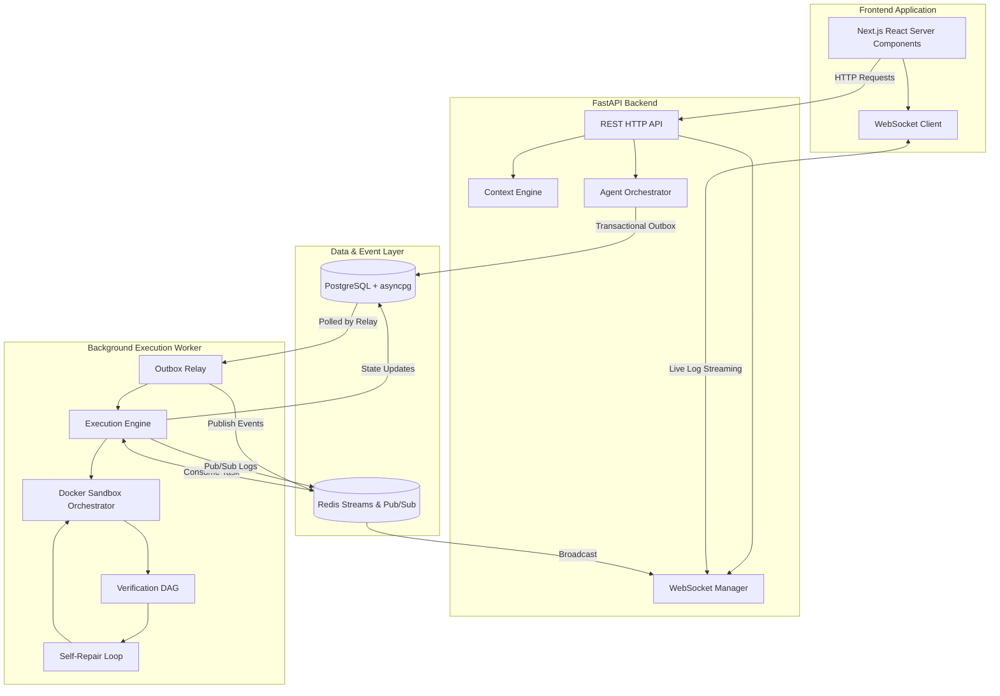

# Forge AI

Forge is an autonomous, end-to-end AI software engineering platform. Designed for production-grade reliability, Forge deeply indexes source code repositories, understands architectural context, translates natural language intents into deterministic execution plans, and executes those plans within isolated Docker sandboxes. 

This document serves as a comprehensive technical overview of the Forge architecture, internal engines, and infrastructure.

## System Architecture

Forge is structured as a distributed microservices architecture, utilizing an event-driven pattern for asynchronous orchestration.



## Core Infrastructure

### 1. Backend Stack
- **Framework**: FastAPI running on Python 3.12.
- **Database**: PostgreSQL accessed asynchronously via `asyncpg` and SQLAlchemy 2.0. Database schema versioning is managed by Alembic.
- **Tenant Isolation**: Implemented using PostgreSQL Row-Level Security (RLS) policies to ensure strict data separation between organizations and workspaces.
- **Event Broker**: Redis is utilized for both stream-based reliable job queues (for background workers) and high-throughput Pub/Sub (for real-time WebSocket terminal log streaming).
- **Transactional Outbox**: To guarantee event delivery, state mutations and their corresponding outbound events are committed atomically to PostgreSQL. An outbox relay polls these records and pushes them to Redis Streams, ensuring zero data loss during process crashes.

### 2. Frontend Stack
- **Framework**: Next.js 14 utilizing the App Router and React Server Components.
- **State & Streaming**: Utilizes native WebSockets to stream standard output (stdout) and standard error (stderr) from the backend Docker containers directly to a custom web-based terminal component.
- **Styling**: Vanilla CSS utilizing modern specifications (OKLCH color spaces, CSS Variables, fluid typography via `clamp()`) replacing utility-first frameworks like Tailwind for precise, bespoke aesthetic control.

## Internal Engines

### Repository Memory Engine
The Repository Memory Engine is responsible for creating a semantic and structural understanding of an imported codebase.
- **AST Parsing**: Utilizes Tree-sitter to parse source code into Abstract Syntax Trees.
- **Symbol Extraction**: Extracts exact line numbers, signatures, and definitions for classes, functions, and variables across multiple programming languages.
- **Dependency Graph**: Constructs an internal directed graph representing file-level dependencies and imports.
- **Storage**: Indexes are persisted in PostgreSQL, facilitating rapid relational queries against structural codebase elements.

### AI Context Engine
To prevent Large Language Models (LLMs) from hallucinating unavailable dependencies or hallucinating internal business logic, the Context Engine dynamically grounds prompts.
- **Context Injection**: During planning, the Context Engine retrieves up to 50 specific `SourceFileModel` contents and up to 20 precise `SymbolModel` definitions relevant to the user's intent.
- **Prompt Assembly**: The retrieved state is rendered via Jinja2 templates into a strict system prompt inside a sandboxed environment, providing the LLM with exact, verifiable project context before it writes a single line of code.

### Planning Engine (Agent Orchestrator)
Forge converts ambiguous human intent into a deterministic, verifiable graph of discrete tasks.
- **DAG Generation**: The LLM outputs a JSON payload representing a Directed Acyclic Graph (DAG). Nodes represent distinct actions: Bash commands, file mutations, or verification scripts. Edges represent execution dependencies.
- **Validation**: The planner enforces strict guardrails. For example, it utilizes predefined heuristic rules to prevent the AI from scheduling arbitrary build scripts (e.g., `npm run build`) unless the Context Engine confirms the script exists in the target repository's manifest (`package.json`).

### Execution Sandbox
Safety and isolation are the primary directives of the execution phase.
- **Docker Orchestration**: The execution worker spins up ephemeral Docker containers specifically designed for the target language environment (e.g., `node` or `python` sandbox images).
- **Volume Mounting**: The target repository is mounted into the container as a workspace volume.
- **Command Execution**: The worker executes the nodes of the DAG inside the container. The host machine is never directly exposed to AI-generated commands.
- **Log Streaming**: Container output streams are captured asynchronously and pushed to Redis Pub/Sub, which routes them to the frontend WebSocket connections for real-time user visibility.

### Verification DAG and Self-Repair
Forge employs a multi-pass diagnostic engine to ensure code correctness before committing changes.
- **Diagnostic Interception**: If a command node fails (resulting in a non-zero exit code), the Verification DAG intercepts the failure.
- **Failure Classification**: The system analyzes the stderr output to classify the failure type (e.g., syntax error, linter violation, failing unit test).
- **Self-Repair Loop**: The error logs and the previously executed file states are routed to a repair worker. The repair worker instructs the LLM to generate a specific `Patch`. The patch is applied to the sandbox volume, and the failed node is retried.
- **Transaction Rollback**: If the DAG cannot stabilize and reach a fully successful terminal state within a predefined maximum number of repair passes, the transaction is aborted. The local workspace is reset, preventing broken code from propagating.

## Security Architecture

- **Authentication**: Managed via GitHub OAuth2 integrations.
- **Credential Management**: GitHub Personal Access Tokens (PAT) are heavily secured. They are encrypted at rest in the PostgreSQL database using AES-GCM (via the internal `CryptoService`).
- **Decryption Lifecycle**: Tokens are only decrypted ephemerally in memory within the background worker process strictly at the moment a verified sandbox execution requires a `git push` back to the remote repository.
- **Network Policies**: Docker sandbox containers are subject to strict network isolation to mitigate potential supply-chain vulnerabilities or rogue AI-generated scripts attempting to access internal network resources.

## Setup and Deployment

### Prerequisites
- Python 3.12+
- Node.js 18+
- Docker Engine and Docker Compose
- `uv` (Astral's high-performance Python toolchain)

### Environment Configuration
1. Duplicate `.env.example` to `.env` in the project root.
2. Populate `GITHUB_CLIENT_ID` and `GITHUB_CLIENT_SECRET` via your GitHub Developer Settings.
3. Generate a secure, high-entropy 32-byte string for `SECRET_KEY`.

### Initialization
Start the persistence layer (PostgreSQL and Redis):
```bash
docker compose up -d postgres redis
```

Install backend dependencies using `uv` and execute the Alembic schema migrations:
```bash
uv sync
uv run scripts/database/run_migrations.py
```

### Running the Services
The platform requires three distinct processes running concurrently.

1. **FastAPI Server**: Handles REST and WebSocket traffic.
```bash
uv run uvicorn apps.api.main:app --reload --host 0.0.0.0 --port 8000
```

2. **Execution Worker**: Consumes the Redis Stream and orchestrates Docker containers.
```bash
uv run python apps/worker/main.py
```

3. **Next.js Frontend**: Serves the user interface.
```bash
cd apps/frontend
npm install
npm run dev
```

The application will be available at `http://localhost:3000`.
