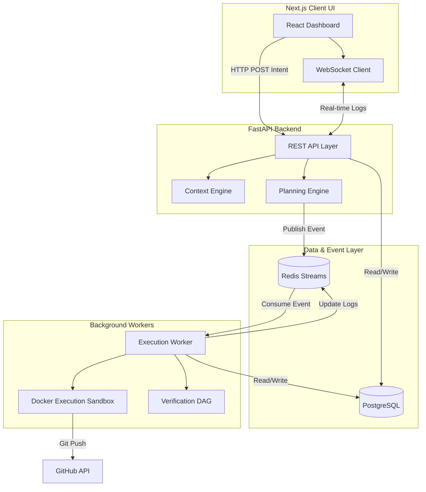

# Forge AI 🚀

Forge is an **autonomous, end-to-end AI software engineering platform**. Unlike standard autocomplete tools or basic chat interfaces, Forge acts as an autonomous engineer. It deeply indexes your repositories, understands architectural context, translates natural language intent into deterministic execution plans, and executes those plans within highly secure, isolated Docker sandboxes. Finally, it uses a multi-pass diagnostic Verification DAG to self-repair build errors before seamlessly pushing the final verified code directly to GitHub.

---

## 🏗️ High-Level Architecture

Forge is split into a robust, event-driven Python backend and a beautiful, real-time Next.js frontend, orchestrated via Docker.



---

## 🧠 Core Engines

Forge is powered by five deeply interconnected engines that work in tandem to ensure safe, autonomous code generation and execution.

### 1. Repository Memory Engine
The Memory Engine acts as Forge's brain. It doesn't just read files as raw text; it uses **Tree-sitter** to parse the abstract syntax trees (AST) of your entire codebase. 
- **Symbol Extraction**: Extracts classes, functions, variables, and their exact locations.
- **Dependency Graph**: Understands what files depend on other files.
- **Vector Indexing**: (Planned) Embeds architectural concepts for semantic retrieval.

### 2. AI Context Engine
When you give Forge a command, the Context Engine dynamically retrieves relevant codebase context. 
- It pulls up to 50 deeply related `SourceFileModels` and 20 `SymbolModels`.
- It injects these into the LLM prompt, ensuring the AI operates **without hallucinating** non-existent functions or missing critical dependencies.

### 3. Planning Engine
Forge does not execute code blindly. The Planning Engine acts as the architect.
- **Intent Parsing**: Converts your human request into a deterministic **Directed Acyclic Graph (DAG)**.
- **Task Scheduling**: The DAG schedules bash commands, file mutations, and verifications in a strict, topologically sorted order.
- **Guardrails**: Hard rules are enforced (e.g., preventing arbitrary `npm run build` commands on repositories without them).

### 4. Execution Sandbox
Safety is the highest priority. All generated plans are executed in an isolated sandbox.
- **Docker Orchestration**: The Python worker spins up ephemeral Docker containers.
- **State Isolation**: File edits, bash commands, and `npm`/`pip` installs happen *inside* the container. The host machine is never exposed to untrusted AI-generated code.
- **Real-Time Streaming**: `stdout` and `stderr` are streamed over Redis pub/sub back to the FastAPI layer, which broadcasts them over WebSockets to the frontend.

### 5. Verification DAG & Self-Repair
Forge doesn't just write code; it ensures the code works.
- **Multi-Pass Diagnostics**: If a bash command fails (e.g., a linter error or a broken unit test), the Verification DAG intercepts the exit code.
- **Self-Repair Loop**: It feeds the error logs back into the LLM context, generates a targeted patch, applies it, and runs the verification again.
- **Abort & Rollback**: If the pipeline fails to stabilize after multiple passes, the execution transaction is aborted, and no broken code is pushed to GitHub.

---

## 🎨 Frontend Architecture

The frontend is built for maximum developer velocity and premium aesthetics.

- **Stack**: Next.js 14, React, TypeScript.
- **Styling**: We explicitly avoid Tailwind in favor of a bespoke, vanilla CSS design system. We utilize modern CSS features (OKLCH colors, `clamp()` typography, CSS variables, backdrop-filters) to create a beautiful, dynamic, frosted-glass aesthetic.
- **Real-Time Terminal**: A custom WebSocket-driven terminal component that renders execution logs live as the Docker sandbox processes the DAG.
- **Expandable UI**: Smart truncation handles long AI intents with expandable `<details>` blocks to keep the layout pixel-perfect without sacrificing readability.

---

## 💾 Backend Infrastructure

- **FastAPI**: Handles high-concurrency async HTTP requests and WebSocket connections.
- **PostgreSQL & SQLAlchemy (asyncpg)**: Stores users, tenants, repository metadata, execution plans, and event logs. Uses Row-Level Security (RLS) concepts for tenant isolation.
- **Redis & Hiredis**: Acts as the central nervous system. Uses Redis Streams for reliable job queuing to the background workers, and Pub/Sub for real-time WebSocket log streaming.
- **LiteLLM**: Provides an abstraction layer, allowing Forge to seamlessly route requests to OpenAI, Anthropic, or local open-source models depending on the complexity of the task.

---

## 🛡️ Security & Authentication

- **OAuth2**: Secure login via GitHub OAuth.
- **Token Encryption**: GitHub Personal Access Tokens (PATs) are encrypted at rest using AES-GCM via the `CryptoService`. They are only decrypted ephemerally inside the worker container exactly when pushing to GitHub.
- **Air-gapped Execution**: Network policies limit what the Docker sandbox can reach, mitigating supply-chain attacks from hallucinated dependencies.

---

## 🚀 Setup and Development Guide

### Prerequisites
- Node.js >= 18
- Python >= 3.12
- Docker Desktop
- [uv](https://github.com/astral-sh/uv) (Extremely fast Python package manager)

### 1. Environment Configuration
Copy the sample `.env.example` file to `.env` in the root directory:
```bash
cp .env.example .env
```
Ensure you provide your `GITHUB_CLIENT_ID`, `GITHUB_CLIENT_SECRET`, and an encryption `SECRET_KEY`.

### 2. Infrastructure
Start the PostgreSQL and Redis containers:
```bash
docker compose up -d postgres redis
```

### 3. Backend (API & Worker)
Install backend dependencies and run the database migrations:
```bash
uv sync
uv run scripts/database/run_migrations.py
```
Start the API Server (runs on `http://localhost:8000`):
```bash
uv run uvicorn apps.api.main:app --reload --host 0.0.0.0 --port 8000
```
Start the Background Execution Worker:
```bash
uv run python apps/worker/main.py
```

### 4. Frontend Client
Navigate to the frontend directory, install dependencies, and start the Next.js server:
```bash
cd apps/frontend
npm install
npm run dev
```

Visit **[http://localhost:3000](http://localhost:3000)** to experience Forge AI.

---

## 🤝 Roadmap & Future Work
- **Semantic Vector Search**: Integrate pgvector for deep semantic search across massive monorepos.
- **Multi-Agent Swarms**: Allow the Planning Engine to spawn specialized sub-agents (e.g., a dedicated "Frontend Designer" agent and a "Backend DBA" agent) that negotiate contracts before executing the DAG.
- **Enterprise RBAC**: Role-based access control for organization-level workspaces.

Built with passion for the future of software engineering.
