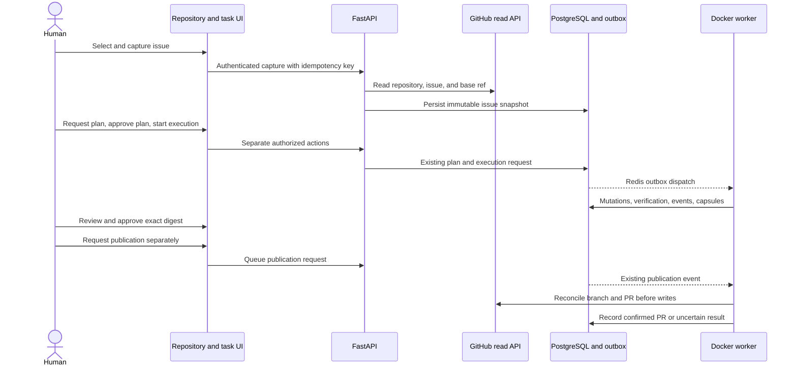

# Issue-to-PR workflow

Forge can bind one accessible, open GitHub issue to an imported repository revision and then use its existing engineering pipeline. This feature does not automatically execute code or publish to GitHub.

## User flow

1. Sign in with GitHub, select a workspace, and import a repository. The import must finish with a full commit SHA. Index the repository and request an Atlas graph for that revision if richer impact evidence is needed.
2. On the repository page, browse open issues or enter an issue number. Forge reads the GitHub repository and issue using the signed-in user's token. It rejects pull requests returned by the issues API, closed issues, invalid payloads, oversized issue text, changed repository identity, and a moved base branch.
3. Review the issue, then select **Capture issue**. The immutable snapshot stores the stable GitHub repository and issue IDs, bounded title/body/labels, canonical URL, branch, base SHA, and capture time. A repeated request for the same issue and base returns the existing workflow. Neither capture nor GitHub webhooks authorize planning, execution, or publication.
4. Select **Generate engineering plan**. This is an explicit model-backed action and may incur provider charges in a configured production deployment. Forge uses a matching published Atlas snapshot when available. Candidate paths from the issue title are heuristic hints, not proven dependencies. If no matching graph exists, the plan must state uncertainty. The existing planner proposes a DAG; its output remains subject to execution path and command policy.
5. Open the linked task workspace. A human must approve the plan and separately start execution. The existing outbox, lease-controlled worker, Docker sandbox, Safety Gate, Flight Recorder, verification, Context Lens, and Run Capsules handle execution and evidence. The issue workflow reads their durable records; it does not own a competing execution status.
6. Inspect actual verification results, changed files, unified diff, and the exact review digest. Human approval records that digest only. Changed patches, stale bases, or missing passing verification cannot be published.
7. A separate **Publish** action queues a publication request. The Docker worker rechecks repository identity, base, GitHub permissions, approval digest, verification, and Safety Gate. It uses a patch-ID-derived `forge/` branch, never the default branch and never a force push. The publisher reconciles an existing remote branch and PR before a retry. A lost GitHub response is shown as `UNKNOWN` until remote state is reconciled; a queued request does not mean a PR exists.
8. A PR is shown as published only after GitHub confirms its number and canonical URL. For an issue workflow, the PR description includes `Fixes #<number>` after the source issue ID and open state are rechecked.

## API and ownership

All routes require an active Forge session and organization permission; the PostgreSQL issue-workflow table has forced tenant RLS. GitHub credentials remain encrypted in the existing user record and are never stored in the issue snapshot. GitHub issue text is untrusted task data and is displayed through escaped React text rendering. It cannot grant execution or publication rights.

- `GET /api/v1/repositories/{id}/issues` lists at most 20 currently open issues from the first page.
- `GET /api/v1/repositories/{id}/issues/{number}` reads one issue and checks the imported branch SHA.
- `POST /api/v1/repositories/{id}/issue-workflows` captures with `{issue_number, idempotency_key}`.
- `GET /api/v1/repositories/{id}/issue-workflows` lists the latest 30 workflow summaries.
- `GET /api/v1/issue-workflows/{id}` and `GET /api/v1/plans/{id}/issue-workflow` restore workflow context after reload.
- `POST /api/v1/issue-workflows/{id}/plan` explicitly invokes the existing planner.

The workflow reports its current state from linked plan, execution, verification, patch, and publication records. `last_error` covers only planning intake errors. Execution, verification, and publication errors remain in their source records. Cancellation and repair follow their existing APIs and bounded policies.

`issue_workflows` stores one source snapshot per organization, provider issue ID, and base SHA. The database uniquely constrains that source, the request idempotency key, and the linked plan. Its trigger rejects changes to the source issue, tenant, or base. The existing plan, execution, verification, repair, patch, Flight Recorder, and Run Capsule records remain the owners of their statuses and historical evidence. A repair execution is followed through its verification link so the source issue remains visible for a revised patch. The workflow read projection can show `ISSUE_CAPTURED`, `AWAITING_EXECUTION_AUTHORIZATION`, `PLAN_READY`, `EXECUTING`, `VERIFYING`, `VERIFICATION_FAILED`, `READY_FOR_PATCH`, `AWAITING_REVIEW`, `REJECTED`, `APPROVED`, `PUBLICATION_FAILED`, `PUBLICATION_UNCERTAIN`, `PUBLISHING`, `CANCELLED`, `FAILED`, or `PUBLISHED`; it never infers a PR from a queued event.

Planning reserves a stable plan ID before invoking the existing planner. If a process dies after the plan commits but before the workflow link commits, the next request attaches that same plan. A failed plan can be retried with the reserved ID. An in-progress reservation refuses a concurrent request; an abandoned reservation may be retried after 15 minutes. Execution duplicates are rejected by the existing plan lock and execution checks. Worker lease fencing, outbox retries, bounded repair attempts, and sandbox cleanup remain in their existing services.

## Operational requirements and limits

- The API needs a PostgreSQL migration to create `issue_workflows` and add the stable GitHub repository ID. Apply Alembic before API startup. Existing imported repositories with no provider ID are bound on first successful issue capture after GitHub confirms the same canonical name; a rename or transfer requires re-import.
- Configure the existing `DATABASE_URL`, `REDIS_URL`, GitHub OAuth credentials, credential encryption key, session signing secret, `WORKSPACE_ROOT`, and Docker worker settings from `DEPLOYMENT.md`. No issue-specific secret or paid service is required. The API needs GitHub read permission for issue intake; future publication requires the existing GitHub push/PR permissions and explicit human action.
- GitHub reads use the current user's OAuth token, a ten-second timeout, and a 256 KiB response cap. The issue body is capped at 32 KiB and labels at 20. The first page of 20 open issues is shown; enter a number for later issues. Invalid or oversized items are omitted from browsing and rejected when selected directly.
- A published Atlas graph is optional. Missing Atlas evidence is disclosed; it is never presented as measured impact. An issue that references unsupported commands or protected paths remains subject to the existing worker and Safety Gate checks.
- Actual code execution and GitHub publication need the separate Docker-capable worker. Vercel and the Render API cannot run that worker. Without it, issue browse/capture and available planning work, while execution and PR creation remain pending.
- Model-backed planning, live GitHub OAuth, and hosted PR publication need separate authorized integration tests. Local Docker worker execution was exercised against disposable infrastructure and a mocked GitHub write adapter; no real GitHub write is part of this development pass.
- For local validation, start disposable PostgreSQL and Redis, apply `alembic upgrade head`, then run `pytest -q tests/unit/test_issue_to_pr.py tests/unit/test_patch_contribution.py tests/integration/test_issue_to_pr_local.py`. The integration test requires `FORGE_ISSUE_TEST_DATABASE_URL` and `FORGE_ISSUE_TEST_CONFIRM_DISPOSABLE=1`; it creates and removes only its own fixture rows. Run the existing worker E2E with its documented disposable `forge_e2e_*` database and Docker socket access. Frontend checks are `node node_modules/typescript/bin/tsc --noEmit`, `node node_modules/next/dist/bin/next lint`, and a production build from `apps/frontend`.
- The API returns 409 for stale repository identity/base or planning still in progress, 422 for invalid or oversized issue data, and 503 for GitHub read outages. A publication `UNKNOWN` state means an external write may have succeeded; inspect the `forge/<patch-id>` branch and PR before retrying. The worker re-reads both before another write. Do not manually delete the branch to clear uncertainty without understanding its ownership and patch digest.

## Deterministic workflow cases

`bench/issue-to-pr-cases-v1.json` pins ten invariant cases to named tests. Run `python bench/run_issue_to_pr_cases.py` from the repository root after setting up a **disposable** migrated PostgreSQL database, restricted `forge_rls_test` role, Redis, a shared workspace, and local Docker socket as required by the worker tests. The runner prints the catalog SHA-256, executes each case, and fails if any selected test fails or skips. It does not invoke the scored Forge Bench coding-task runner or assign a model-quality score.

| Case | Final local result | Evidence boundary |
| --- | --- | --- |
| Simple issue bug fix | 1 passed | Real worker, verification, capsule, mocked GitHub PR |
| Small multi-file change | 1 passed | Two edited files, two passing verifiers, exact patch review |
| Missing Atlas snapshot | 1 passed | Persisted issue and plan with explicit missing-graph statement; model fixture |
| Verification failure | 1 passed | Deterministic failed sandbox response and repair request |
| Repair changes patch digest | 3 passed | Ordered mutation lineage, changed digest, stale approval denied |
| Sensitive-file modification denied | 2 passed | Real Docker worker denies `.env`, stores denial, makes no mutation; persisted policy RLS |
| Unauthorized publication | 2 passed | Other reviewer and other tenant denied before side effects |
| Duplicate publication request | 1 passed | No second outbox publication event |
| Worker interruption and recovery | 1 passed | Killed local lease owner, persisted expiry and fenced new generation |
| Ambiguous GitHub result reconciliation | 6 passed | Disposable Git commit, mocked lost responses, remote reconciliation, one push and PR |

The final catalog run passed **all ten cases: 19 tests, zero failed, zero skipped**. External GitHub responses and writes were mocked. The first attempted worker run failed because its disposable container lacked Docker socket permission; rerunning as root inside that test container passed. This does not change the production worker's configured privilege model.

## Final local validation and limits

On 15 November 2026, the complete backend suite against the final source and a freshly migrated disposable PostgreSQL/Redis stack passed: **255 passed, 36 skipped, 57 warnings, zero failed**. The restricted `forge_rls_test` role was created before the suite. Skips comprised Docker/shared-workspace-gated suites, fake-sandbox-only variants, and two explicitly obsolete tests. The selected worker and Safety Gate Docker cases were run separately with a shared workspace and Docker socket. Warnings were existing Pydantic class-config deprecations, Starlette `httpx` deprecation, short test JWT key warnings, and a provider TypedDict warning; none were suppressed.

The signed-in Playwright test against the local FastAPI app, PostgreSQL, Redis, and copied Next frontend passed after reload (**1 passed**). Its persisted workflow came from the real local worker, with GitHub publication mocked. Fresh Alembic upgrade, seeded upgrade from `a4d1e8c2b930` with an existing patch/reviewer/plan chain, single head `b6f1a2c3d4e5`, and `alembic check` passed. Ruff's CI selection, production-source Pyright (0 errors), TypeScript, Next lint with telemetry disabled, Docker Compose, and API, worker, and frontend production Docker builds passed. The broader `ruff check .` reported **79 style findings** elsewhere in the repository; that configuration is not the current CI gate, and its findings were not suppressed. Production Python pip-audit and frontend npm audit found **zero** known vulnerabilities; the full frontend audit still found **six moderate development-tool** advisories.

Issue-to-PR is locally complete for a separate Git review and hosted-validation phase. Live GitHub OAuth/read/write, live model planning, remote CI, hosted API/frontend/worker, and a real hosted PR remain unverified. Do not treat this local invariant catalog as coding-model accuracy or production readiness.
